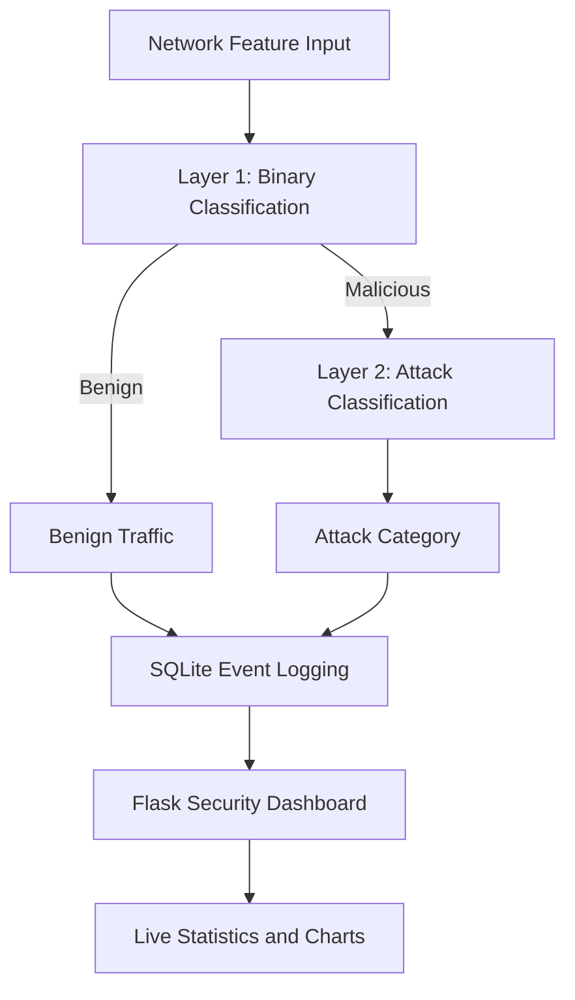

# 🛡️ Hi-MLIC: Hierarchical Multi-Layer Lightweight Intrusion Classification for Various Intrusions

### A Python-Based Network Intrusion Classification and Security Monitoring Prototype

Hi-MLIC is a cybersecurity mini project designed to demonstrate a hierarchical, multi-layer approach to network intrusion classification.

The system uses a Flask-based backend, SQLite database, and an interactive web dashboard to simulate network traffic, display security events, and visualize different intrusion categories.

## 🚀 Project Overview

The system follows a two-layer classification architecture:

- **Layer 1 — Binary Classification:** Distinguishes benign and malicious traffic.
- **Layer 2 — Attack Classification:** Categorizes malicious traffic into different intrusion types.

The current implementation uses simulated traffic and placeholder classification logic to demonstrate the architecture and monitoring workflow.

## 🛠️ Technologies Used

- Python
- Flask
- NumPy
- SQLite
- HTML5 and CSS3
- Bootstrap 5
- JavaScript
- Chart.js

## ✨ Key Features

### 🔐 Hierarchical Intrusion Classification
- Two-stage intrusion classification architecture.
- Layer 1 distinguishes benign and malicious traffic.
- Layer 2 identifies the category of malicious activity.
- Supports Light and Full deployment modes in the prototype.

### 📊 Real-Time Security Dashboard
- Interactive web dashboard built using Flask.
- Displays total requests and detected threats.
- Visualizes benign and malicious traffic.
- Automatically refreshes every 3 seconds.
- Displays recent intrusion logs.

### 🚨 Supported Attack Categories
The traffic simulator generates five attack categories:

- Distributed Denial of Service (DDoS)
- SQL Injection
- Brute Force
- Port Scanning
- Cross-Site Scripting (XSS)

### 📈 Security Analytics
- Attack distribution doughnut chart.
- Recent detection trend line chart.
- Threat percentage indicator.
- Visual alerts for malicious events.

### 🗄️ Database Integration
- SQLite database for persistent event logging.
- Stores classification results and deployment modes.
- Maintains timestamps and feature vectors.

## ⚠️ Current Implementation Status

Hi-MLIC is currently a functional monitoring prototype.

The dashboard and database logging are implemented.
Network traffic is simulated, and classification
predictions use placeholder logic rather than trained
machine-learning models.

The architecture is designed to support future
integration of trained binary and multiclass classifiers.

## 🏗️ System Architecture

Hi-MLIC follows a hierarchical two-layer intrusion
classification architecture.



### Classification Workflow

1. Network feature vectors are received through the API.
2. The first layer determines whether traffic is benign or malicious.
3. Malicious traffic proceeds to the second classification layer.
4. The classification result is stored in SQLite.
5. The Flask dashboard displays logged events and analytics.

**Note:** The current implementation uses placeholder
classification logic and a separate simulated traffic generator.
Trained machine-learning models are not yet integrated.

## ⚙️ Installation and Setup

### Prerequisites

- Python 3.10 or later
- pip (Python package manager)
- Git
- A modern web browser

### 1. Clone the Repository

```bash
git clone https://github.com/YOUR_USERNAME/Hi-MLIC-Intrusion-Classification.git
cd Hi-MLIC-Intrusion-Classification
```

Replace `YOUR_USERNAME` with your GitHub username.

### 2. Create a Virtual Environment

```bash
python3 -m venv .venv
source .venv/bin/activate
```

### 3. Install Dependencies

```bash
pip install -r requirements.txt
```

### 4. Initialize the Database

```bash
python database.py
```

### 5. Run the Flask Application

```bash
python app.py
```

### 6. Open the Dashboard

Visit:

http://127.0.0.1:5000

The dashboard displays simulated network traffic,
intrusion logs, attack distributions, and security statistics.

### Stop the Application

Press `Ctrl + C` in the terminal.

## 🎥 Project Demonstration

Watch the Hi-MLIC prototype in action.

The demonstration showcases the Flask security
dashboard, simulated network traffic, intrusion
statistics, attack distribution, and event logs.

### Demo Video
**Demo video:** Coming soon.
